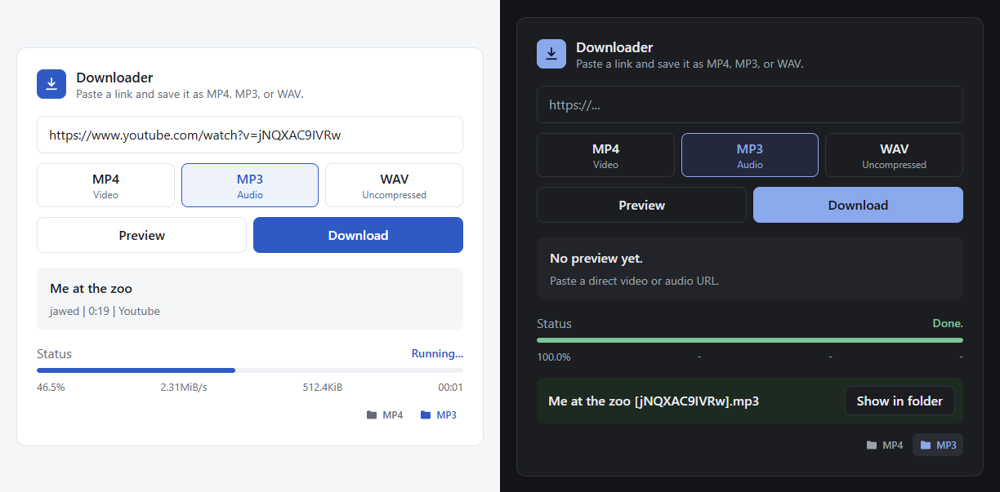
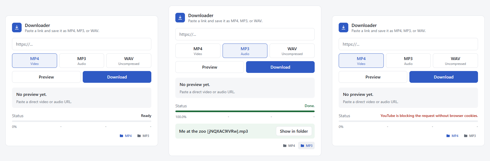

# Downloader

A small desktop app for **Windows, macOS, and Linux** that saves a link as **MP4** video or **MP3** / **WAV** audio. Paste a link, pick a format, click Download. Videos and audio go to separate folders that you choose.

It uses [yt-dlp](https://github.com/yt-dlp/yt-dlp) for page links and [ffmpeg](https://ffmpeg.org/) for converting and merging. Direct links to media files (`.mp4`, `.mp3`, `.wav`, …) work too.



## Features

- MP4, MP3, or WAV from any page yt-dlp supports, or from a direct media link
- separate save folders for video (MP4) and audio (MP3/WAV)
- pastes a copied link automatically when the window opens
- waits in the system tray (menu bar on macOS) and can open at login
- optional console commands: type `mp3` or `video` in a terminal to open it with that format selected
- keeps yt-dlp up to date by itself (checked at most once a week)
- light and dark mode, following the system
- also runs as a local web app with Node.js



## Install

Download the file for your system from the [latest release](https://github.com/MartinGeltl21/media-downloader/releases/latest):

| System | File |
| --- | --- |
| Windows 10/11 | `Downloader-<version>-win-x64.zip` |
| macOS with Apple silicon (M1 and later) | `Downloader-<version>-mac-arm64.zip` |
| macOS with Intel | `Downloader-<version>-mac-x64.zip` |
| Linux x64 | `Downloader-<version>-linux-x64.tar.gz` |

Downloader needs ffmpeg on every system. The app is not code-signed, so each system warns once on first start; the steps below get past that.

### Windows

1. Install ffmpeg: `winget install Gyan.FFmpeg`
2. Unzip the download and move the `Downloader` folder somewhere it can stay, for example to `%LOCALAPPDATA%\Programs\Downloader`. The console commands point to this folder, so turn them off before moving it later.
3. Run `Downloader.exe`. If SmartScreen warns, choose **More info** and then **Run anyway**.
4. To keep it handy, right-click its taskbar icon and choose **Pin to taskbar**.

### macOS

1. Install ffmpeg with [Homebrew](https://brew.sh/): `brew install ffmpeg`
2. Unzip the download and drag `Downloader.app` into **Applications**.
3. Open it. macOS blocks apps from unidentified developers the first time: open **System Settings → Privacy & Security**, scroll down, and click **Open Anyway** next to the message about Downloader. Alternatively, run this once in Terminal:

   ```bash
   xattr -dr com.apple.quarantine /Applications/Downloader.app
   ```

### Linux

1. Install ffmpeg, for example `sudo apt install ffmpeg` (Debian, Ubuntu) or `sudo dnf install ffmpeg` (Fedora, with RPM Fusion).
2. Unpack the download and let Electron's sandbox helper run as intended:

   ```bash
   mkdir -p ~/.local/opt
   tar -xzf Downloader-*-linux-x64.tar.gz -C ~/.local/opt
   sudo chown root:root ~/.local/opt/Downloader/chrome-sandbox
   sudo chmod 4755 ~/.local/opt/Downloader/chrome-sandbox
   ~/.local/opt/Downloader/Downloader
   ```

   If you cannot use `sudo`, start it with `~/.local/opt/Downloader/Downloader --no-sandbox` instead.
3. The tray icon needs a desktop with tray support. On GNOME, that is the AppIndicator extension, which Ubuntu includes.

## Using it

1. Copy a link, for example a YouTube video URL.
2. Open Downloader. The copied link is already in the field.
3. Pick **MP4**, **MP3**, or **WAV** and click **Download**.
4. When it finishes, **Show in folder** reveals the file.

The two folder icons at the bottom right, **MP4** and **MP3**, choose where videos and audio are saved. Hover over one to see the current folder. By default, videos go to your `Videos/Downloader` (`Movies/Downloader` on macOS) folder and audio to `Music/Downloader`.

Closing the window only hides it. Downloader keeps running in the tray, so it opens instantly next time. Use **Quit** in the tray menu (or Cmd+Q on macOS) to stop it.

### Open at login

In the tray menu, enable **Start with Windows** (Windows) or **Open at login** (macOS, Linux). Downloader then starts hidden in the tray when you sign in.

### Console commands

In the tray menu, enable **Console commands (mp3, video)**. Then, in a **new** terminal window:

| Command | Opens Downloader with |
| --- | --- |
| `mp3` | MP3 selected |
| `video` | MP4 selected |

Copy a link, type `mp3`, press Enter, and click Download. Turning the option off removes the commands again.

- **Windows**: adds the app's command folder to your user `PATH`. Works in PowerShell, Command Prompt, and Windows Terminal; Git Bash does not run `.cmd` files by name.
- **macOS**: creates `mp3` and `video` in `~/.local/bin` and adds that folder to `PATH` in `~/.zprofile`.
- **Linux**: creates `mp3` and `video` in `~/.local/bin`. Most distributions put that folder on `PATH` automatically; if it did not exist before, sign out and back in once.

Existing files with these names are never overwritten.

## Build from source

Requirements: Node.js 20 or newer and ffmpeg.

```bash
git clone https://github.com/MartinGeltl21/media-downloader.git
cd media-downloader
npm install
```

| Command | What it does |
| --- | --- |
| `npm run app` | runs the desktop app from source |
| `npm run release` | builds the app for the current system and packs it into `dist/` |
| `npm start` | runs the web version at `http://localhost:3210` |
| `npm run check` | syntax check for all scripts |
| `npm run install-app` | Windows only: builds the app, installs it to `%LOCALAPPDATA%\Programs\Downloader`, adds Start menu and desktop shortcuts, and turns on autostart and the console commands |

`npm run release -- --arch=arm64` builds for another CPU architecture. On Windows, `install-app` accepts `-NoAutostart` and `-NoCommands`:

```powershell
powershell -ExecutionPolicy Bypass -File scripts/install-windows.ps1 -NoAutostart -NoCommands
```

Pushing a tag like `v1.1.0` builds all four packages on GitHub Actions, smoke-tests them, and attaches them to the release.

## Web version

`npm start` serves the same interface in the browser at `http://localhost:3210` and saves files to the `downloads/` folder in the project. The folder icons and console commands are only part of the desktop app.

The web version needs a real server process: it runs yt-dlp and ffmpeg and writes files to disk. Static hosting (GitHub Pages, Netlify) and most serverless platforms cannot run it. A VPS or your own machine can.

Environment variables:

| Variable | Default | Purpose |
| --- | --- | --- |
| `PORT` | `3210` | port of the web server |
| `HOST` | all interfaces | address to listen on, for example `127.0.0.1` |
| `FFMPEG_PATH` | found on `PATH` | full path to `ffmpeg` |
| `YT_DLP_COOKIES_FILE` | `cookies.txt` | cookie file for signed-in sources |
| `YT_DLP_COOKIES_FROM_BROWSER` | none | read cookies from `chrome`, `edge`, `brave`, `firefox`, or `safari` |

## Signed-in sources and cookies

Some posts (for example age-restricted or private Reddit and YouTube content) are only available to signed-in accounts. Downloader then needs your browser cookies in a Netscape-format `cookies.txt` in its data folder (see the next section), or in the project folder for the web version. The file is picked up automatically, also when you add it while the app is running.

One way to create it is to close the browser completely and run the yt-dlp that Downloader keeps in its data folder once. On Windows:

```powershell
& "$env:APPDATA\Downloader\bin\yt-dlp.exe" --cookies-from-browser chrome --cookies "$env:APPDATA\Downloader\cookies.txt" --skip-download "LINK_TO_A_POST"
```

On macOS (use `~/.config/Downloader` instead on Linux):

```bash
~/Library/Application\ Support/Downloader/bin/yt-dlp --cookies-from-browser chrome --cookies ~/Library/Application\ Support/Downloader/cookies.txt --skip-download "LINK_TO_A_POST"
```

`cookies.txt` contains your login sessions. Never share or commit it.

## Where things are stored

| What | Windows | macOS | Linux |
| --- | --- | --- | --- |
| finished videos (changeable) | `Videos\Downloader` | `Movies/Downloader` | `Videos/Downloader` |
| finished audio (changeable) | `Music\Downloader` | `Music/Downloader` | `Music/Downloader` |
| settings, yt-dlp, cookies, temporary files | `%APPDATA%\Downloader` | `~/Library/Application Support/Downloader` | `~/.config/Downloader` |

## Troubleshooting

**"ffmpeg is missing"**: install ffmpeg as described under Install, then quit Downloader from the tray and start it again.

**YouTube says it is blocking the request or asks to confirm you are not a bot**: add cookies as described above. yt-dlp updates itself weekly; if a site just changed, wait for the next yt-dlp release or delete the `yt-dlp` file in the `bin` folder of the data folder to fetch the latest one on next start.

**"Please paste a direct YouTube video link"**: search, channel, and profile pages are not supported. Open the video and copy its address.

**`mp3` is not found**: enable the console commands in the tray menu and open a new terminal window.

**Linux: it does not start and the terminal mentions the sandbox**: run the two `sudo` commands from the Linux install steps, or start it with `--no-sandbox`.

**Some MP4 files do not play in an editor**: YouTube often delivers AV1 video. Most players handle it; some editors need an AV1 codec or a conversion first.

## How it works

The desktop app is an [Electron](https://www.electronjs.org/) shell (`desktop/`) around the web app. It starts `server.js` in the background under Electron's bundled Node.js, opens the interface in its own window, and moves finished files into the folder for their format. `server.js` is an [Express](https://expressjs.com/) server that downloads the standalone yt-dlp build for the current system on first use and runs it with Node.js as its JavaScript runtime. The interface in `public/` is plain HTML, CSS, and JavaScript.

## Responsible use

Only download content you have the right to download, and respect the terms of the sites you use and the rights of creators. This project is not affiliated with YouTube, Reddit, or any other site.

## Credits and license

The original web app was written by [Leonxlnx](https://github.com/Leonxlnx). The desktop app, tray, console commands, and redesign were added by [MartinGeltl21](https://github.com/MartinGeltl21).

Released under the [MIT License](LICENSE). yt-dlp and ffmpeg are separate projects with their own licenses; Downloader downloads yt-dlp at runtime and expects ffmpeg to be installed separately.
